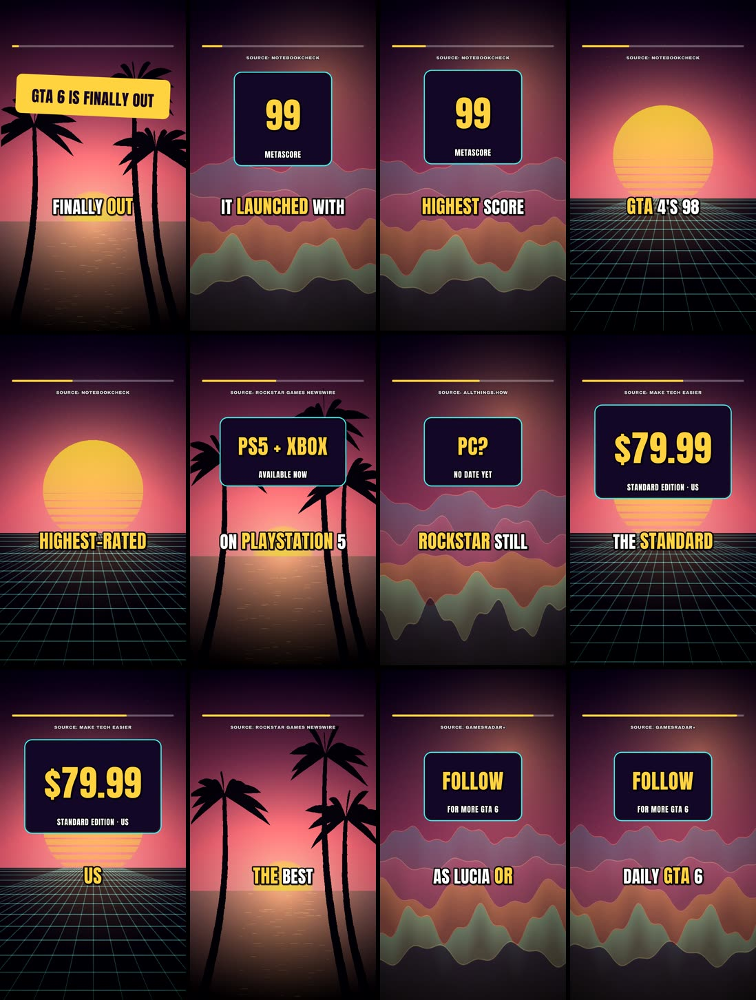

# GTA 6 Shorts — automated, fact-checked, zero-cost

An almost fully automated system that researches, writes, narrates, edits,
quality-checks and (once you allow it) publishes English **GTA 6 YouTube Shorts
and TikTok videos** — running entirely in the cloud on free services, so your
PC can stay off and the only thing you pay for is Claude Pro.



## Status (2026‑11‑19 — GTA 6 launch day)

| Stage | State |
|---|---|
| **1 · Foundation** | ✅ built and tested — pipeline, voice, captions, editing, QA, dashboard, docs, workflows |
| **2 · Testing** | 🟡 test videos rendered; waiting for your review and for `AUTOMATION_ENABLED` |
| **3 · Publishing** | ⏸️ code ready, **switched off**; needs your YouTube connection and approval |
| **4 · Full automation** | ⏸️ later, after Stage 3 works |

Nothing is published anywhere until you change `publishing.enabled` in
[`config/settings.yaml`](config/settings.yaml) *and* connect an account.

## What a video gets

- **1080×1920, 30 fps, 20–60 s**, H.264/AAC at −14 LUFS (what Shorts/TikTok expect)
- a **hook in the first second** (big tilted title + impact sound, voice starts at ~0.07 s)
- **energetic AI narration** — an original blend of Kokoro‑82M voices (open licence, no cloning)
- **word-by-word captions** with the spoken word highlighted, **fact cards**, on-screen
  **source credits** and a progress bar
- **original animated backgrounds** (synthwave sun, palms, ocean, night city, police lights,
  warp streaks), five colour themes, varied transitions — no game footage
- **original music** composed by code for every video, ducked under the voice
- an **automatic QA report** (16 checks) and a **fact check** of every claim
- an honest description: sources, AI-voice disclosure, "not affiliated with Rockstar"

## How it works

```
news leads ─┐                       ┌─ Kokoro voice + word timing ─┐
facts.yaml ─┼─► script ─► FACT CHECK ┼─ captions & graphics (ASS) ─┼─► FFmpeg ─► QA ─► review issue
Claude/LLM ─┘                       └─ backgrounds + music + SFX ─┘                      │ you: approved
                                                                                         ▼
                              dashboard ◄─ daily report ◄─ stats ◄─ YouTube / TikTok ◄─ publishing gate
```

Details: [docs/ARCHITECTURE.md](docs/ARCHITECTURE.md)

## What you need to do

1. Watch the test videos and tell me what to change (voice, look, pacing).
2. Follow [docs/SETUP.md](docs/SETUP.md): GitHub settings (5 min) → YouTube (20–30 min) →
   TikTok developer app (needs TikTok's approval).
3. Decide whether I should schedule the Claude editor session
   ([automation/claude-editor.md](automation/claude-editor.md)).

## Repository layout

| Path | Contents |
|---|---|
| `config/settings.yaml` | every switch (stages, voice, captions, limits) |
| `config/styles.yaml` | colour themes, fonts, background styles, transitions |
| `content/facts.yaml` | verified facts with sources — the only source of claims |
| `content/scripts/` | one YAML script per video |
| `src/gta6shorts/` | the pipeline (Python) |
| `tests/` | 82 automated tests |
| `.github/workflows/` | CI, produce, publish, stats & dashboard |
| `data/` | video registry, statistics, usage counters (written by the workflows) |
| `reports/daily/` | daily reports |
| `assets/` | fonts (OFL/Apache) and optional licensed music |
| `docs/` | architecture, setup, operations, compliance, costs, roadmap |

## Run it locally (optional — the cloud does this for you)

Needs Python 3.11+, FFmpeg and espeak-ng.

```bash
pip install -r requirements.txt && pip install -e .
```

```bash
python -m gta6shorts doctor
```

```bash
python -m gta6shorts render 2026-11-19-gta6-launch-day
```

```bash
python -m pytest -q
```

## Documentation

- [SETUP.md](docs/SETUP.md) — accounts, secrets, switching stages on
- [OPERATIONS.md](docs/OPERATIONS.md) — daily routine, manual runs, troubleshooting
- [COMPLIANCE.md](docs/COMPLIANCE.md) — copyright, accuracy, AI disclosure, platform rules
- [COSTS_AND_LIMITS.md](docs/COSTS_AND_LIMITS.md) — every free tier and how it's monitored
- [ROADMAP.md](docs/ROADMAP.md) — what's done, what's next
- [ARCHITECTURE.md](docs/ARCHITECTURE.md) — design and decisions

Fan project — not affiliated with or endorsed by Rockstar Games or Take-Two Interactive.
