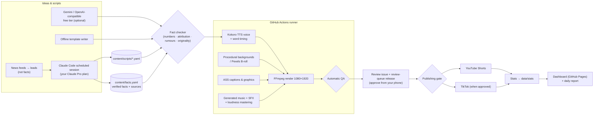

# Architecture

> Design document for the GTA 6 Shorts automation. It describes what is built,
> why it is built that way, and which decisions are still open.

## 1. Intent

An English YouTube Shorts / TikTok channel about GTA 6 that runs almost by
itself, in the cloud, for **0 DKK** beyond the owner's Claude Pro plan. Videos
must be **accurate, original and rule-abiding**: no game footage, no unlicensed
music, no rumours presented as facts, no impersonation of real creators.

**Goals:** daily vertical videos (20–60 s) with a strong hook, energetic AI
narration, burned-in captions and professional editing; automatic quality
control; human approval until trust is earned; statistics, daily reports and a
dashboard.

**Non-goals (for now):** long-form videos, live streams, comment replies, paid
growth, gameplay recording.

**Anti-goals (failure even if it "works"):** a false claim; a copyright strike;
a video that looks mass-produced and gets demonetised as "inauthentic content";
anything that bypasses platform approval or account rules.

## 2. Constraints that shaped the design

| Constraint | Consequence |
|---|---|
| Zero cost | GitHub Actions (free for public repos), open models, generated art & music |
| PC can be off | Everything runs in GitHub Actions; review happens in the GitHub mobile app |
| Claude Pro has no API access and no rendering | Claude is used as an *editor* (scheduled Claude Code session writing scripts); rendering happens on GitHub's runners |
| No copyrighted gameplay/trailers/music | Visuals are procedural motion graphics (+ optional free-licence stock clips); music is synthesised by code |
| Facts must be verified | Every claim must cite a fact in `content/facts.yaml`, which carries sources, a status and a re-check window |
| Platform rules | Publishing gate, AI-content disclosure flags, approval queue, TikTok audit respected |
| **GitHub Models was retired on 2026‑07‑30** | The in-Actions writer uses Gemini's free tier or any OpenAI-compatible endpoint instead, plus an offline fallback |

## 3. System overview



## 4. Components (all in `src/gta6shorts/`)

| Module | Job |
|---|---|
| `facts.py` | Loads/validates the fact base; freshness; automatic re-checks of source pages |
| `script.py` | Script model (one YAML per video: hook, lines, cards, facts, tags) |
| `factcheck.py` | The linter that blocks inaccurate, unattributed, rumour-based, baity, repetitive or wrong-length scripts |
| `writer.py`, `llm.py` | Script drafting: Gemini / OpenAI-compatible free tiers with a repair loop, offline templates |
| `research.py` | News headlines → `data/research/` as *topic leads only* |
| `tts.py`, `align.py` | Kokoro‑82M narration (blended original voice), pause tightening, word timing |
| `captions.py`, `styles.py` | Word-by-word captions, hook box, fact cards, source credits, progress bar (ASS/libass) |
| `visuals.py`, `stock.py` | Six procedural background styles; optional Pexels B-roll |
| `music.py`, `audio.py` | Original synthwave track per video, SFX, ducking, two-pass EBU R128 mastering |
| `render.py` | Timeline, transitions (xfade), zoom punches, grain, vignette, encode, thumbnail, contact sheet |
| `qa.py` | Format, duration, loudness, true peak, black/frozen frames, dead air, hook timing, captions, fact check |
| `registry.py` | `data/videos.json` — lifecycle of every video |
| `review.py` | Review issues + `review-queue` pre-release on GitHub |
| `gate.py` | Every condition that must be true before an upload |
| `youtube.py`, `tiktok.py` | Upload + statistics clients |
| `analytics.py`, `report.py`, `dashboard.py` | Snapshots, metrics, daily report, static dashboard |
| `pipeline.py`, `cli.py` | Jobs used by the workflows (`python -m gta6shorts …`) |

## 5. Video lifecycle

```
script (ready) ─► rendered ─► qa_failed                (never publishable)
                          └─► awaiting_review ─► rejected   (asset deleted, issue closed)
                                             └─► approved ─► published (per platform)
                                                          └─► publish_failed (retried later)
```

## 6. Workflows (`.github/workflows/`)

| Workflow | When | What |
|---|---|---|
| `ci.yml` | every push / PR | tests, fact check, **real cloud render with the Kokoro voice** |
| `produce.yml` | daily 11:00 Danish time* or manual | leads → fact re-check → scripts → videos → QA → review issues |
| `publish.yml` | your label records the decision; approved videos upload daily at 13:00 Danish time* | applies your decision; uploads if the gate allows |
| `stats.yml` | daily 14:00 Danish time* or manual | statistics → report → dashboard on GitHub Pages |

\* Scheduled runs only happen when the repository variable `AUTOMATION_ENABLED`
is `true`. Manual runs always work.

## 7. Approaches considered

**Where to render.** *GitHub Actions* (chosen: free and unlimited for public
repos, 4 vCPU, FFmpeg available) vs. Claude cloud sessions (not meant for
compute, uses your plan's limits) vs. free cloud VMs (sign-up friction, card
required, limits change).

**Who writes scripts.** *Claude Code scheduled session* (chosen as the main
editor: uses the plan you already pay for and can research the web) with free
LLM tiers and templates as fallbacks. GitHub Models was the original in-Actions
choice but it was retired in July 2026.

**Visuals.** *Procedural motion graphics* (chosen: original, can't be claimed)
with optional Pexels clips. Gameplay/trailers were ruled out by your copyright
rule; AI image/video generators were ruled out by cost and inconsistent licences.

**Voice.** *Kokoro‑82M* (chosen: Apache‑2.0, high quality, runs on CPU) vs.
Edge TTS (free but unclear commercial terms) vs. Piper (lower energy, mixed
voice licences) vs. espeak-ng (robotic — kept only as a test fallback).

**Captions timing.** Estimated from the audio (pause anchoring + phoneme
weights) instead of speech recognition, which avoids another model download.

## 8. Open decisions (yours)

- Channel name/handle and narrator voice preset (`config/settings.yaml`).
- When to enable the schedule (`AUTOMATION_ENABLED`) and the scheduled Claude editor.
- When to switch on publishing (Stage 3) and later `publishing.mode: auto` (Stage 4).
